<div align="center">


[🇪🇸 Español](README.md) · **🇬🇧 English**

**80s bottle-cap games: a turn-based cycling race and bottle-cap football, to play on your phone or tablet.**<br>
Made to play with my daughters.

[](https://serbenda.github.io/chapas/)

[](https://github.com/serbenda/chapas/actions/workflows/tests.yml)


</div>

---

## 🚴 The idea

In 1980s Spain, every schoolyard had the same game: draw a race track on the ground with chalk and flick *chapas* (bottle caps with a photo of your favourite cyclist inside) along it, imitating *La Vuelta*, the Spanish grand tour. **La Vuelta de Chapas** brings that game back for a new generation, on phones and tablets, with the look and sound of an 80s arcade machine.

> The game is available in **English and Spanish**: it starts in your phone's language and you can switch with **ES / EN** in the menu.

<table>
<tr>
<td width="34%" align="center" valign="top">
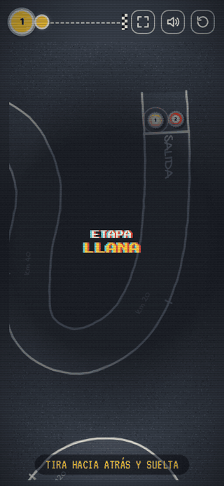<br>
<sub><b>A race on a phone:</b> the hand shows the gesture and the computer plays its turn</sub>
</td>
<td width="66%" valign="top">

### In 30 seconds

- 👆 **Pull back and let go**, like a slingshot.
- 🛣️ **Leave the road and you go back.** Or play with barriers in easy mode.
- ⚽ **Two games**: **cycling** and **bottle-cap football**.
- 🏔️ **4 stages**: flat, mountain, cobblestones and grand finale.
- ✏️ **Draw your own track** with your finger, like chalk in the schoolyard.
- 💛 **Yellow and polka-dot jerseys**, with overall standings.
- 🤖 **Play against the computer**, with 3 levels.
- 📸 **Your photo inside the cap**, like the old ones.
- 📻 **A commentator** who calls every shot.
- 🌍 **In English and Spanish**, with an ES / EN switch in the menu.

</td>
</tr>
</table>

## 🗺️ The four stages

| | |
| :---: | :---: |
| 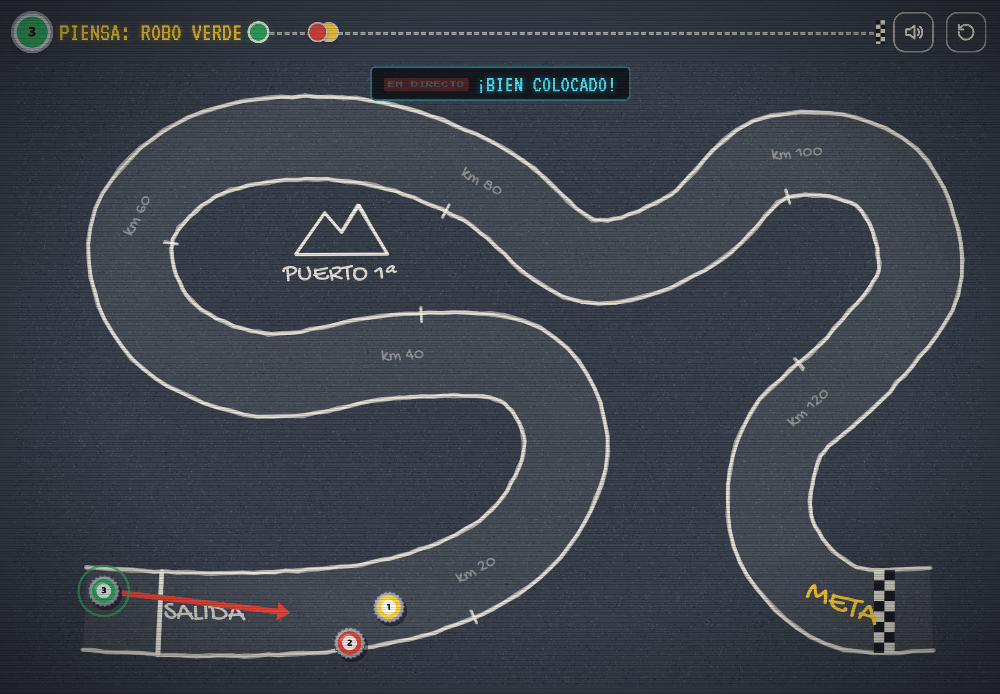 | 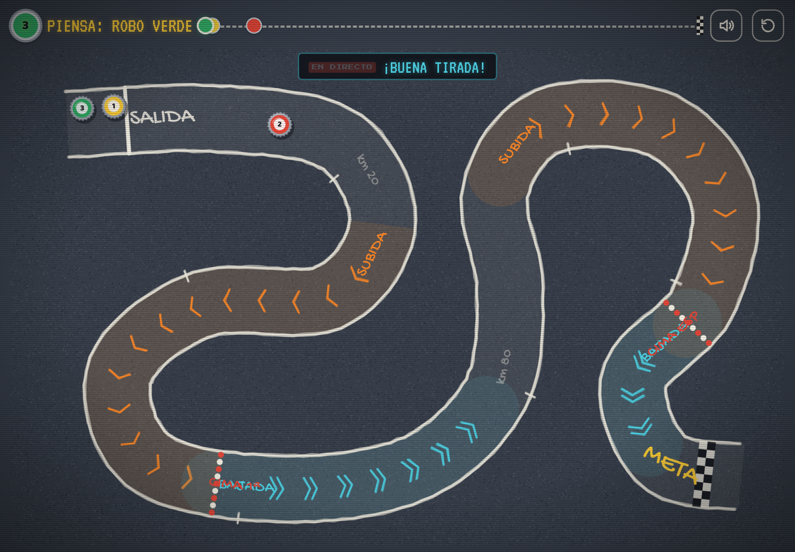 |
| **1 · Flat**: to get the hang of it | **2 · Mountain**: climbs that slow you down, descents that launch you and two mountain primes |
|  | 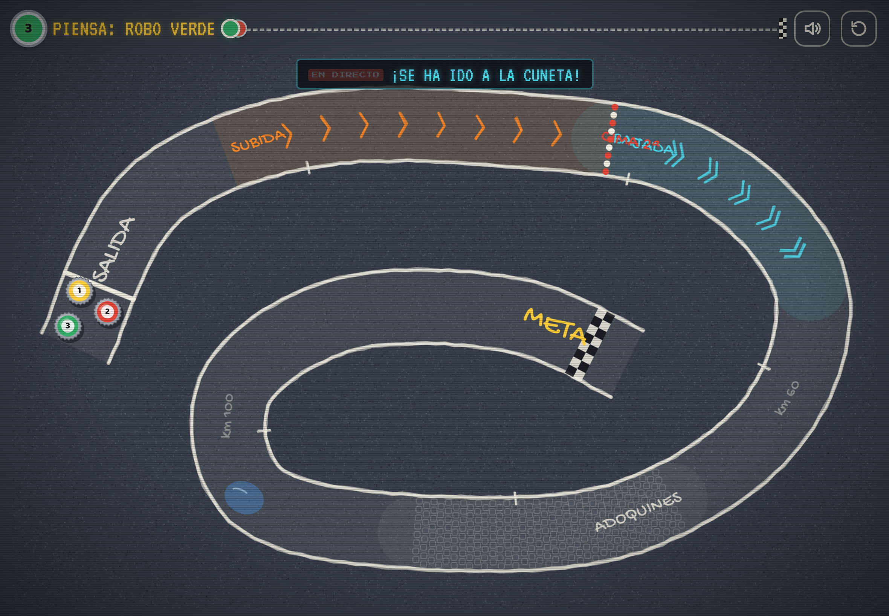 |
| **3 · Cobblestones**: caps bounce and puddles make them slide | **4 · Grand finale**: a bit of everything, with the finish in the middle of the spiral |

## ✏️ Draw your own track

| Drawing with your finger | Track ready! |
| :---: | :---: |
| 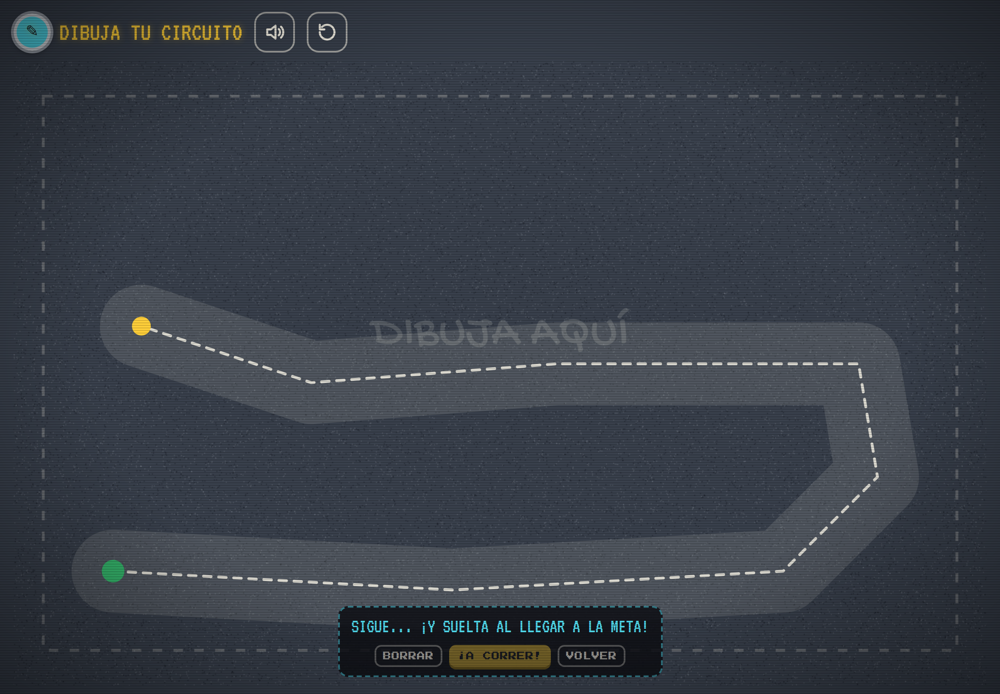 | 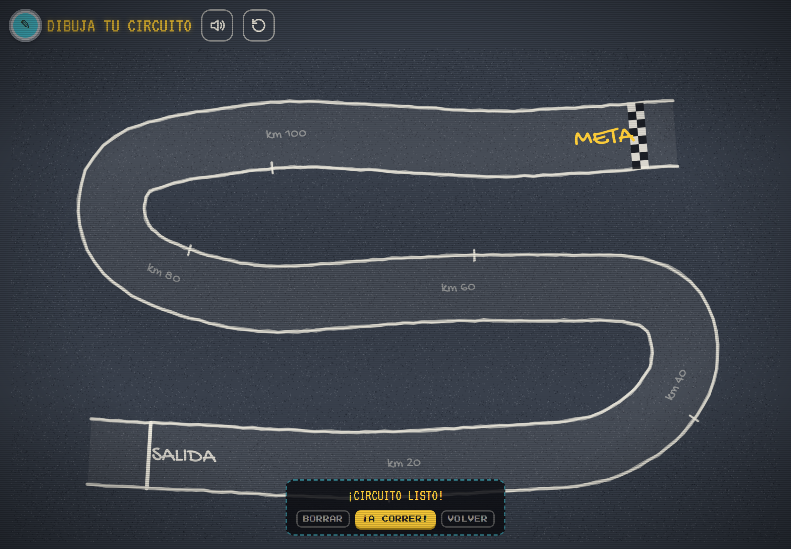 |

Just like in the schoolyard: on the riders screen tap **DIBUJA TU CIRCUITO** (draw your track) and paint the road with your finger, from start to finish. The game smooths the line, turns it into a chalk track and tells you if something doesn't work:

| If… | It says |
| --- | --- |
| It's too short | *¡Muy corto!* (Too short! Make it longer) |
| Two stretches touch | *¡Las carreteras se tocan!* (The roads touch! Move them apart) and circles the spot in red |
| A bend is impossible | First it tries to smooth it by itself; if it can't, *¡Curva muy cerrada!* (Bend too tight!) |

The track is saved on the device and appears as **5. TU CIRCUITO** to race again, also against the computer.

## ⚽ Bottle-cap football

| Match against the computer | Goal! |
| :---: | :---: |
| 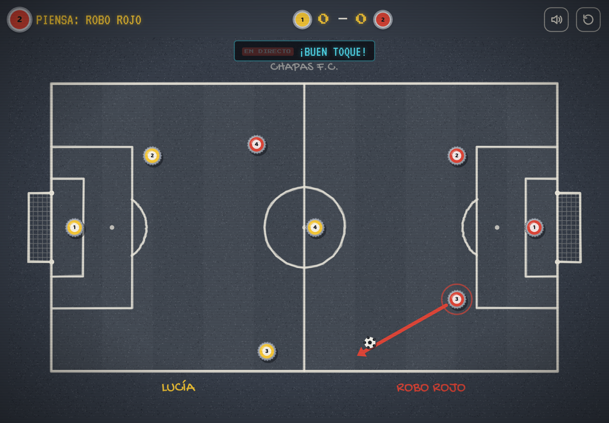 | 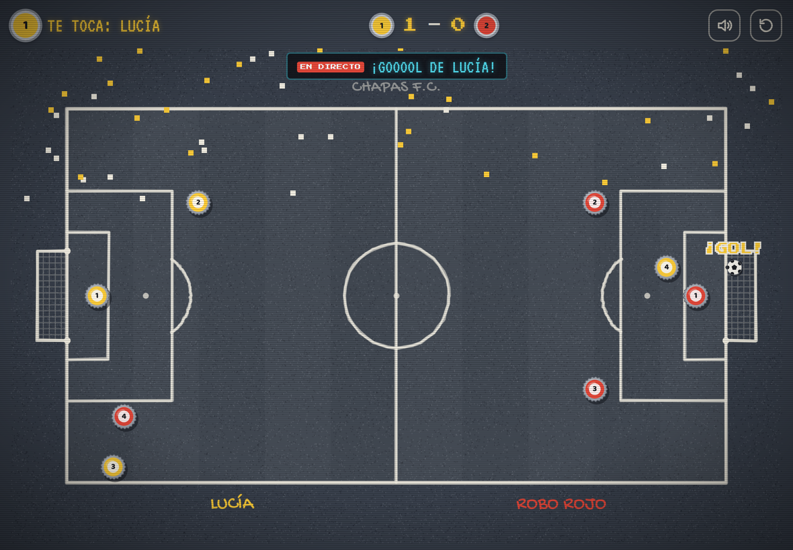 |

Each team has **4 caps** (goalkeeper, two defenders and a striker) and players take turns: **pick one of your caps**, flick it and hit the ball. The pitch has a kerb, so nothing goes out, and the first to **3 or 5 goals** wins. After each goal, the team that conceded kicks off.

## 🏆 Standings and podium

| Overall standings | Stage podium |
| :---: | :---: |
| 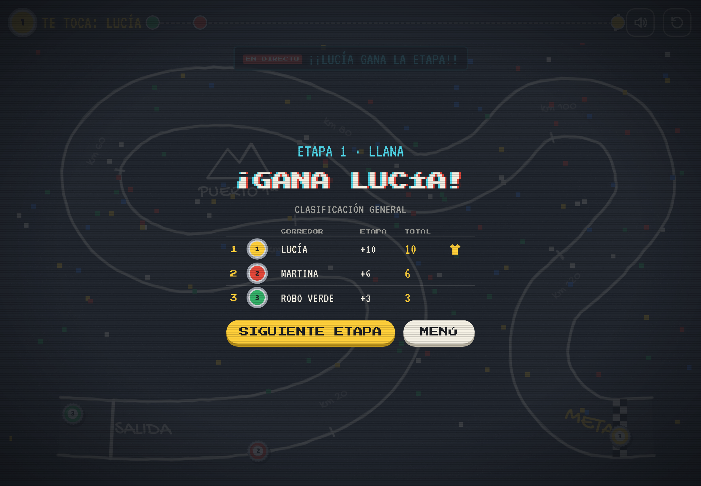 | 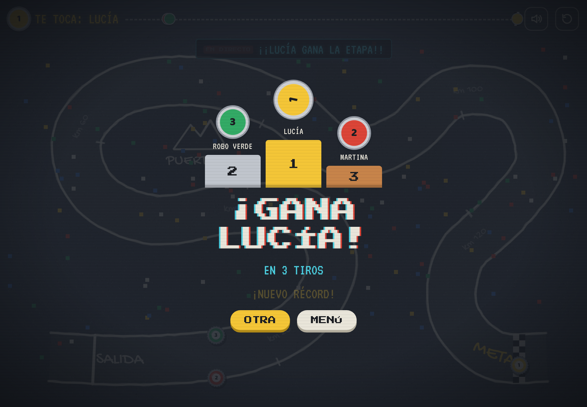 |

## 📱 On the phone

| Menu | Riders | Race | Football |
| :---: | :---: | :---: | :---: |
| 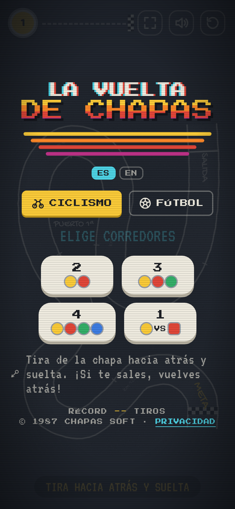 | 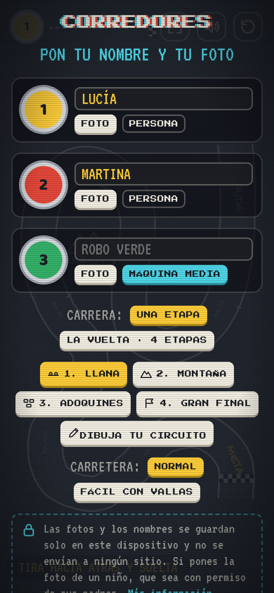 | 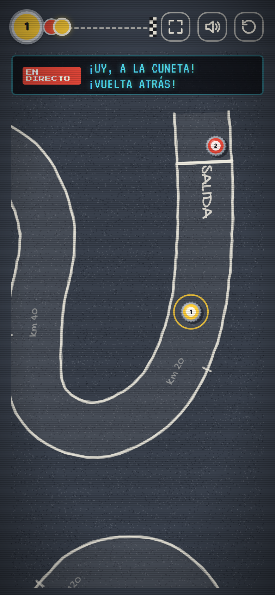 | 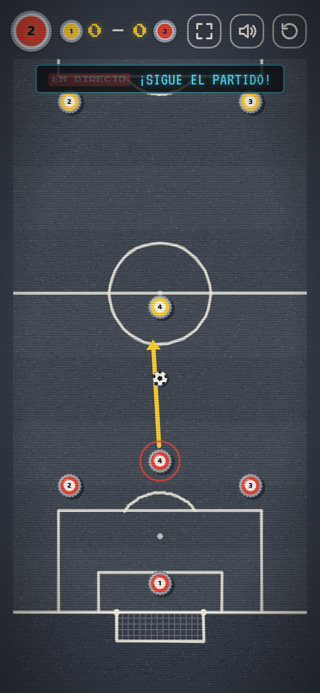 |
| **Cycling** or **football**, and how many players | Name, photo, human or computer, and race type | The camera zooms in on the cap being played | The camera follows the ball |

> All images are generated automatically by a bot that plays real races every time the game changes (see [Automatic screenshots](#-automatic-screenshots)).

## 🎮 How to play

### 🚴 Cycling

1. **Choose CICLISMO** (cycling) in the menu and how many riders are playing: 2 to 4 sharing the same phone or tablet, or 1 against the computer.
2. **Add your name and photo** to your cap, and choose whether each cap is played by a person or the computer.
3. **Choose the race**: a single stage or the full **Vuelta**, with 4 stages.
4. **Take turns**: when the banner shows your cap, touch the screen, **pull back** and **let go**. The arrow shows the power: 🟢 soft · 🟡 medium · 🔴 full.
5. **The first cap to cross the finish line wins.** In the Vuelta, whoever scores the most points wins.

### 📜 Schoolyard rules

| What happens | Result |
| --- | --- |
| Your cap leaves the road | `¡FUERA!` (Out!) It goes back to where it was before the shot. In **easy mode** it bounces off the barriers |
| You hit another cap | You push it. If it leaves the road, it goes back to its spot too |
| **Climb** 🟧 | The cap slows down more |
| **Descent** 🟦 | The cap runs faster |
| **Cobblestones** | The cap bounces and drifts a little |
| **Puddle** 💧 | It slides and spins |
| You cross the finish line | You win the stage |

### ⚽ Football

1. **Choose FÚTBOL** in the menu: 2 players or 1 against the computer.
2. Add a name and photo to your team (the photo appears on all 4 caps) and choose how many goals to play to.
3. On your turn, **touch one of your caps** (your team's caps glow), pull back and let go.
4. If the ball fully enters the opponent's goal, **goal!**

### 💛 Points and jerseys (the Vuelta)

| | Points | Jersey |
| --- | --- | --- |
| **Finish** | 1st 10 · 2nd 6 · 3rd 3 · 4th 1 | **Yellow** for the overall leader |
| **Summit** (when the shot ends past it) | 1st 5 · 2nd 3 · 3rd 1 | **Polka-dot** for the king of the mountains |

Jerseys are shown as a ring around the cap during the race.

## 🤖 The computer

The computer doesn't cheat: **it tries dozens of shots with the game's own physics** and keeps the one that goes furthest without leaving the road. Among the best, it picks the safest one: the shot that still works if its hand shakes a little. Then it plays it with an error that depends on the level:

| Level | Shots tried | Aim |
| --- | --- | --- |
| Easy | ~54 | Misses quite a lot: perfect for letting kids win |
| Medium | ~104 | Good |
| Hard | ~228 | Almost perfect |

In **football**, the computer does the same with each of its 4 caps: it aims to hit the ball from behind in line with your goal, tries several directions and strengths, and picks the play that brings the ball closest to your goal without leaving it near its own.

## 📻 The commentator

A live radio commentator (*EN DIRECTO*) calls every shot, letter by letter, like old Spanish cycling broadcasts:

| When | What he says | Meaning |
| --- | --- | --- |
| Long shot | *¡Qué demarraje!* · *¡Se escapa!* | What an attack! · He's breaking away! |
| Short shot | *¡Pájara!* | He's hit the wall (cycling slang) |
| You leave the road | *¡Uy, a la cuneta!* | Oops, into the ditch! |
| Collision | *¡Chocazo en el pelotón!* | Big crash in the peloton! |
| On a climb | *¡Qué dura es la subida!* | What a tough climb! |
| On cobblestones | *¡Cómo bota en los adoquines!* | Look at it bounce on the cobbles! |
| First over a summit | *¡Lucía corona la cima en cabeza!* | Lucía crests the summit first! |
| You take the lead | *¡Nuevo líder: Rojo!* | New leader: Red! |
| ⚽ Goal | *¡GOOOOL de Lucía!* · *¡Gol en propia puerta!* | GOOOAL by Lucía! · Own goal! |
| ⚽ Ball hits the post | *¡Al palo! ¡Uyyy!* | Off the post! Ooh! |
| ⚽ Missing the ball | *¡Ni rozarlo!* | Didn't even touch it! |

## ✨ Features

- 🕹️ **80s arcade style**: pixel fonts, CRT TV effect and 8-bit music generated live.
- 🖍️ **Chalk race tracks** on asphalt, with start line, kilometre marks, summits, terrain and a chequered finish.
- 🍾 **Caps just like the real ones**: 21-tooth crown, coloured jersey, race number and **your photo**.
- 👆 **Text-free tutorial**: the first time, a hand shows the gesture.
- 🚧 **Easy mode with barriers**, for the youngest.
- 📢 **Turn banner** and **zoom camera** on phones.
- 📳 **Real bottle-cap sound** and **vibration** on Android.
- 📦 **Installable app (PWA)** that **works offline**.
- 🔒 **No ads, no accounts and no data collection.**

## 🔒 Privacy

The game is designed to comply with the GDPR and Spain's data protection law (LOPDGDD) without asking anyone for anything: **it never processes personal data outside the device itself**.

| | |
| --- | --- |
| **What is stored** | Each cap's name, photo (cropped to 160 × 160 px) and player type, best scores per stage, the track you draw and preferences |
| **Where** | Only in that phone or tablet's browser `localStorage`. Nothing is sent to any server |
| **What it doesn't do** | No cookies, no analytics, no ads and no trackers |
| **Fonts** | When published, the fonts are copied to the game's own site: it makes no requests to Google |
| **Photos of children** | The game reminds players to only add a child's photo with their parents' or guardians' permission |
| **Deleting** | **QUITAR** (Remove) button on each photo, or **BORRAR MIS DATOS** (Delete my data) on the *Privacidad* screen |

## 📲 Install on your phone

| Android (Chrome) | iPhone / iPad (Safari) |
| --- | --- |
| Open [serbenda.github.io/chapas](https://serbenda.github.io/chapas/) → menu **⋮** → **Install app** | Open [serbenda.github.io/chapas](https://serbenda.github.io/chapas/) → **Share** → **Add to Home Screen** |

After opening it once with a connection, you can play offline.

## 🛠️ Under the hood

Plain HTML, CSS and JavaScript, in **ES modules with no dependencies and no build step**, drawing on a `<canvas>`.

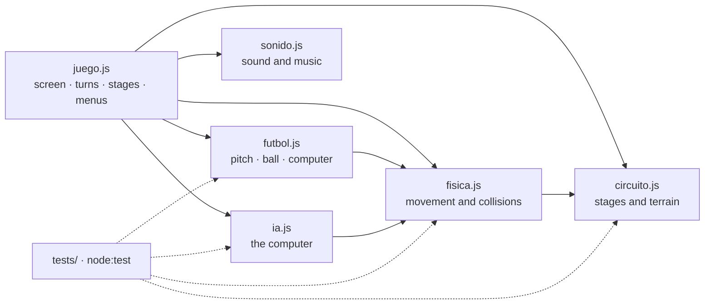

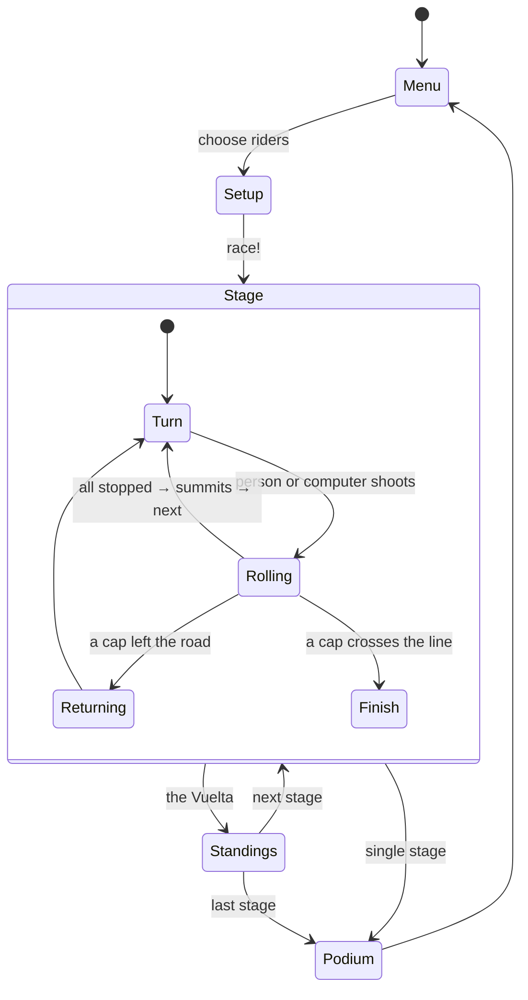

| Part | How it works |
| --- | --- |
| **Tracks** | *Catmull-Rom* curves resampled every 6 units; terrain, summits and puddles are defined as fractions of the route |
| **Physics** | Pure module: fixed 60 Hz step with 4 substeps, terrain-dependent friction and elastic collisions. It returns events (`fuera`, `choque`, `valla`, `meta`) |
| **Leaving the road** | Each substep looks for the nearest point of the road within a local window: no shortcuts jumping from one stretch to another |
| **Computer** | Simulates every candidate shot with the same physics, scores progress and distance from the edge, checks the robustness of the best ones and adds level-based error |
| **Screen** | The world is 1000 × 620; in portrait it is transposed, and text and photos are drawn separately so they are never mirrored |
| **Camera** | If a cap would look small, it zooms in and follows it; the background is painted once at zoom resolution and then just cropped |
| **Sound** | Effects and music synthesised with Web Audio: no audio files |
| **Football** | Same shooting engine; its own physics with masses (the ball weighs half and rolls further), a kerb with gaps at the goals, posts, and a goal when the ball fully crosses the line |
| **Hand-drawn tracks** | The stroke is resampled every 50 units and smoothed as many times as needed to remove impossible bends; then it checks the length and that no stretch touches another |
| **Offline** | A *service worker* caches the game and its modules the first time |

### 📁 Structure

```
chapas/
├── web/                         # The game: this is what gets published to GitHub Pages
│   ├── index.html               # Markup and styles
│   ├── manifest.webmanifest     # App install metadata
│   ├── sw.js                    # Service worker: offline play
│   ├── icons/                   # Bottle-cap app icons
│   └── js/
│       ├── textos.js            # All texts in Spanish and English
│       ├── juego.js             # Screen, camera, drawing, turns, stages, menus and editor
│       ├── circuito.js          # The 4 stages, terrain and hand-drawn track validation
│       ├── fisica.js            # Movement, collisions, barriers and terrain (pure)
│       ├── ia.js                # The cycling computer player
│       ├── futbol.js            # Football: pitch, ball, goals and its computer player (pure)
│       └── sonido.js            # Sound effects and 8-bit music
├── tests/                       # Tests with node:test
│   ├── fisica.test.mjs          # Tracks, physics and computer player
│   ├── futbol.test.mjs          # Football
│   └── trazado.test.mjs         # Hand-drawn tracks
├── scripts/
│   ├── capturas.mjs             # Bot that plays and takes screenshots
│   ├── empaquetar.mjs           # Bundles everything into a single HTML file
│   ├── fuentes_locales.py       # Copies the fonts to the site when publishing
│   └── banner.html              # README header
├── docs/img/                    # README images (automatic)
├── .github/workflows/
│   ├── tests.yml                # Tests on every change and pull request
│   ├── capturas.yml             # Regenerates the README images
│   └── pages.yml                # Publishes web/ to GitHub Pages
├── README.md · README.en.md
└── LICENSE
```

### 💻 Run it locally

```bash
git clone https://github.com/serbenda/chapas.git
cd chapas
python3 -m http.server 8000 -d web   # modules don't load from file://
# open http://localhost:8000

node --test tests/*.test.mjs     # tests
```

> If you change the game, bump the version in `web/sw.js` (`chapas-v10` → `chapas-v11`) so phones download the new one.

### 🌿 Branches

| Branch | Purpose |
| --- | --- |
| `main` | Stable version: the one published at [serbenda.github.io/chapas](https://serbenda.github.io/chapas/) |
| `development` | Where new features are tested before reaching `main` through a *pull request* |

### 🤖 Automatic screenshots

Every time the game changes, [GitHub Actions](.github/workflows/capturas.yml) opens it in a real Chromium with **Playwright**, plays races on all four stages, takes tablet and phone screenshots, builds the GIF with **ffmpeg** and commits them to `docs/img/`.

## 🗺️ Roadmap

- [x] Cycling race for 2 to 4 players
- [x] Retro style: 8-bit music, commentator and high score
- [x] Installable app that works offline
- [x] Your name and photo on the cap
- [x] Turn banner and zoom on phones
- [x] Easy mode with barriers, tutorial, podium, vibration and cap sound
- [x] Multi-stage Vuelta with yellow and polka-dot jerseys
- [x] Terrain: climbs, descents, cobblestones and puddles
- [x] Play against the computer, with 3 levels
- [x] Modular code and automated tests
- [x] ⚽ Bottle-cap football, against a person or the computer
- [x] ✏️ Draw your own track with your finger
- [x] 🌍 The game in English and Spanish

## ⚖️ License

© 2026 Santiago. **All rights reserved.** You may play the game and read the code, but you may not copy, modify or redistribute it without permission. See [LICENSE](LICENSE).

Fonts: *Press Start 2P*, *VT323*, *Gochi Hand* and *Baloo 2*, from Google Fonts, under the SIL Open Font License.

<div align="center">
<br>
<sub>Made with 🖍️ chalk, 🍾 bottle caps and lots of nostalgia · © 1987 CHAPAS SOFT</sub>
</div>
