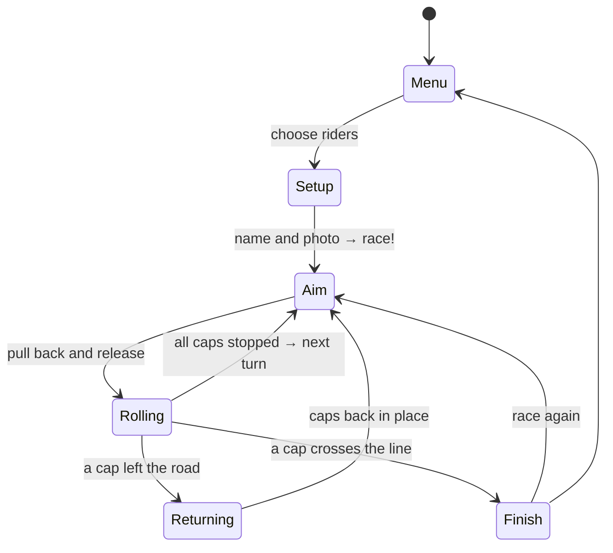

<div align="center">


[🇪🇸 Español](README.md) · **🇬🇧 English**

**An 80s bottle-cap racing game: a turn-based cycling race to play on your phone or tablet.**<br>
Made to play with my daughters.

[](https://serbenda.github.io/chapas/)


</div>

---

## 🚴 The idea

In 1980s Spain, every schoolyard had the same game: draw a race track on the ground with chalk and flick *chapas* (bottle caps with a photo of your favourite cyclist inside) along it, imitating *La Vuelta*, the Spanish grand tour. **La Vuelta de Chapas** brings that game back for a new generation, on phones and tablets, with the look and sound of an 80s arcade machine.

> The game itself is in Spanish, but it is designed to be played with almost no reading.

<div align="center">

</div>

## 📸 Screenshots

| Tablet | Phone |
| :---: | :---: |
|  |  |
|  |  |

> The screenshots and the GIF are generated automatically by a bot that plays a real race every time the game changes (see [Automatic screenshots](#-automatic-screenshots)).

## 🎮 How to play

1. **Choose how many riders** are playing: 2 to 4, sharing the same phone or tablet.
2. **Add your name and photo** to your cap (optional: otherwise you play as your colour).
3. **Take turns**: when the banner shows your cap, touch the screen, **pull back** like a slingshot and **let go**.
4. The arrow shows direction and power: 🟢 soft · 🟡 medium · 🔴 full.
5. **The first cap to cross the chequered finish line wins.**

### 📜 Schoolyard rules

| What happens | Result |
| --- | --- |
| Your cap leaves the road | `¡FUERA!` (Out!) It goes back to where it was before the shot. In **easy mode** it bounces off the barriers |
| You hit another cap | You push it. If it leaves the road, it goes back to its spot too |
| You cross the finish line | You win the stage! Confetti and fanfare |
| You win in fewer shots than ever | `¡NUEVO RÉCORD!` (New record!) Saved on that device |

## 📻 The commentator

A live radio commentator (*EN DIRECTO*) calls every shot, letter by letter, like old Spanish cycling broadcasts:

| When | What he says | Meaning |
| --- | --- | --- |
| Long shot | *¡Qué demarraje!* · *¡Se escapa!* | What an attack! · He's breaking away! |
| Short shot | *¡Pájara!* | He's hit the wall (cycling slang) |
| You leave the road | *¡Uy, a la cuneta!* | Oops, into the ditch! |
| Collision | *¡Chocazo en el pelotón!* | Big crash in the peloton! |
| You take the lead | *¡Nuevo líder: Rojo!* | New leader: Red! |

## ✨ Features

- 🕹️ **80s arcade style**: pixel fonts, CRT TV effect and 8-bit music generated live with Web Audio.
- 🖍️ **Chalk race track** on asphalt, with start line, kilometre marks, a first-category mountain pass and finish line.
- 🍾 **Caps just like the real ones**: 21-tooth crown, coloured jersey and race number.
- 📸 **Your photo inside the cap**, like the cyclist caps of old, and your name on the scoreboard. They are remembered for the next race.
- 👆 **Text-free tutorial**: the first time, a hand shows the pull-and-release gesture.
- 🚧 **Easy mode with red-and-white barriers**: caps bounce instead of leaving the road. Perfect for the youngest.
- 🏆 **Final podium** with the top three on their steps.
- 📳 **Real bottle-cap sound** (a synthesised metallic *clack*) and **vibration** on collisions on Android.
- 📢 **Full-screen turn banner** with a spinning cap: everyone always knows whose turn it is.
- 🔍 **Zoom camera on phones**: it follows the cap being played so it looks big, and a button shows the whole track.
- 📱 **Fits any screen**: in portrait, the track rotates to make the most of the phone.
- 📦 **Installable app (PWA)**: own icon, full screen and **works offline**.
- 🧒 **Designed for 6 to 8 year olds**: hardly any text, big buttons and no harsh penalties.
- 🔒 **No ads, no accounts and no data collection.** Photos stay on the device and are never uploaded.

## 🔒 Privacy

The game is designed to comply with the GDPR and Spain's data protection law (LOPDGDD) without asking anyone for anything: **it never processes personal data outside the device itself**.

| | |
| --- | --- |
| **What is stored** | Each cap's name and photo (cropped to 160 × 160 px), the high score and the game mode |
| **Where** | Only in that phone or tablet's browser `localStorage`. Nothing is sent to any server |
| **What it doesn't do** | No cookies, no analytics, no ads and no trackers |
| **Fonts** | When published, the fonts are copied to the game's own site, so it makes no requests to Google and never sends them the player's IP address |
| **Photos of children** | The game reminds players to only add a child's photo with their parents' or guardians' permission |
| **Deleting** | **QUITAR** (Remove) button on each photo, or **BORRAR MIS DATOS** (Delete my data) on the *Privacidad* screen |

## 📲 Install on your phone

| Android (Chrome) | iPhone / iPad (Safari) |
| --- | --- |
| Open [serbenda.github.io/chapas](https://serbenda.github.io/chapas/) → menu **⋮** → **Install app** | Open [serbenda.github.io/chapas](https://serbenda.github.io/chapas/) → **Share** → **Add to Home Screen** |

After opening it once with a connection, you can play offline.

## 🛠️ Under the hood

The whole game lives in **a single `index.html`**, with no frameworks or libraries: plain HTML, CSS and JavaScript drawing on a `<canvas>`.



| Part | How it works |
| --- | --- |
| **Track** | *Catmull-Rom* curve over 23 control points, resampled every 6 units to measure progress and detect when a cap leaves the road |
| **Physics** | Fixed 60 Hz step with 4 substeps, 2.8 % friction per frame and elastic collisions between caps |
| **Leaving the road** | Each substep looks for the nearest point of the road within a local window, so there are no shortcuts jumping from one stretch to another |
| **Screen** | The world is 1000 × 620 units and is scaled to the screen; in portrait it is transposed, and text and photos are drawn separately so they are never mirrored |
| **Camera** | If a cap would be smaller than 30 px, the camera zooms in and follows it smoothly; the background is painted once at zoom resolution and then just cropped |
| **Barriers** | In easy mode, when a cap reaches the edge it is pushed back inside and its velocity is reflected across the road normal, losing 30 % |
| **Photos** | Cropped to a 160 px square JPEG and stored in `localStorage`: they never leave the device |
| **Sound** | Effects and 8-bit music synthesised with Web Audio oscillators: no audio files |
| **Offline** | A *service worker* caches the game and the fonts the first time |

### 📁 Structure

```
chapas/
├── index.html               # The whole game
├── manifest.webmanifest     # App install metadata
├── sw.js                    # Service worker: offline play
├── icon-*.png               # Bottle-cap icons
├── docs/                    # README screenshots and GIF (automatic)
├── scripts/
│   ├── capturas.mjs         # Bot that plays and takes screenshots
│   └── banner.html          # README header
└── .github/workflows/
    ├── capturas.yml         # Runs the bot on every change
    └── pages.yml            # Publishes the game to GitHub Pages
```

### 💻 Run it locally

```bash
git clone https://github.com/serbenda/chapas.git
cd chapas
python3 -m http.server 8000
# open http://localhost:8000
```

> If you change `index.html`, bump the version in `sw.js` (`chapas-v5` → `chapas-v6`) so phones download the new one.

### 🌿 Branches

| Branch | Purpose |
| --- | --- |
| `main` | Stable version: the one published at [serbenda.github.io/chapas](https://serbenda.github.io/chapas/) |
| `development` | Where new features are tested before reaching `main` through a *pull request* |

### 🤖 Automatic screenshots

Every time the game changes, [GitHub Actions](.github/workflows/capturas.yml) opens it in a real Chromium with **Playwright**, plays a race, takes tablet and phone screenshots, builds the GIF with **ffmpeg** and commits them to `docs/`. It can also be run by hand from the *Actions* tab.

## 🗺️ Roadmap

- [x] Cycling race for 2 to 4 players
- [x] Retro style: 8-bit music, commentator and high score
- [x] Installable app that works offline
- [x] Your name and photo on the cap
- [x] Turn banner and zoom on phones
- [ ] ⚽ Bottle-cap football mode
- [x] Easy mode with barriers, tutorial, podium, vibration and cap sound
- [ ] Multi-stage race with yellow and mountain jerseys
- [ ] Play against the computer
- [ ] More tracks: time trial, high mountains, city circuit

## ⚖️ License

© 2026 Santiago. **All rights reserved.** You may play the game and read the code, but you may not copy, modify or redistribute it without permission. See [LICENSE](LICENSE).

Fonts: *Press Start 2P*, *VT323*, *Gochi Hand* and *Baloo 2*, from Google Fonts, under the SIL Open Font License.

<div align="center">
<br>
<sub>Made with 🖍️ chalk, 🍾 bottle caps and lots of nostalgia · © 1987 CHAPAS SOFT</sub>
</div>
