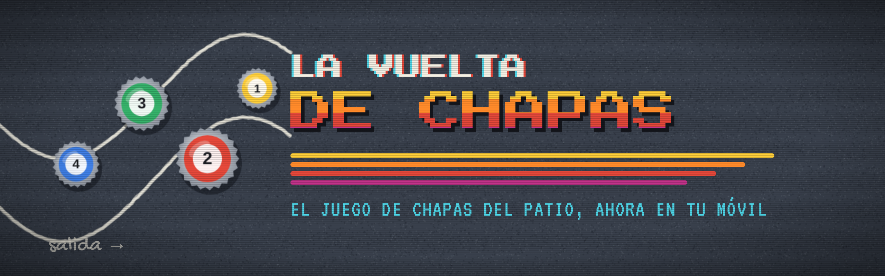
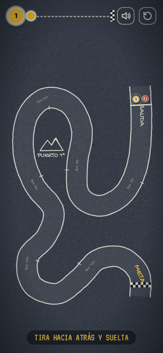
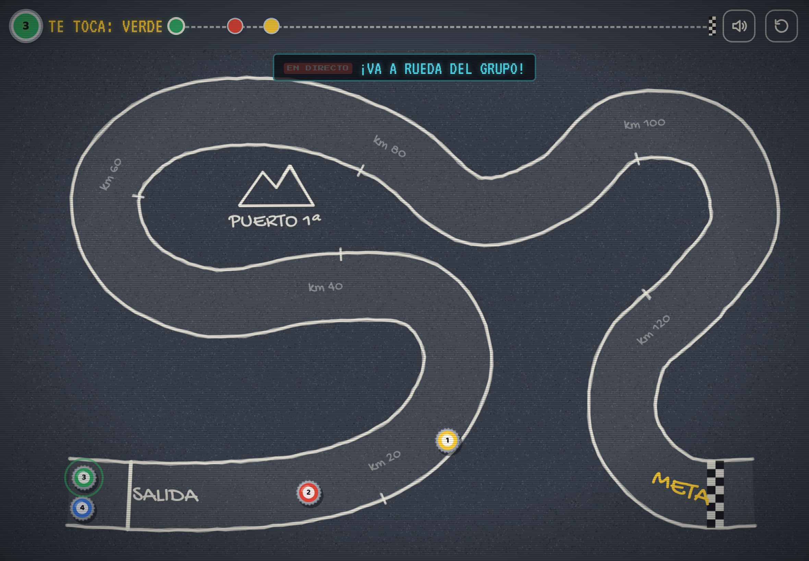
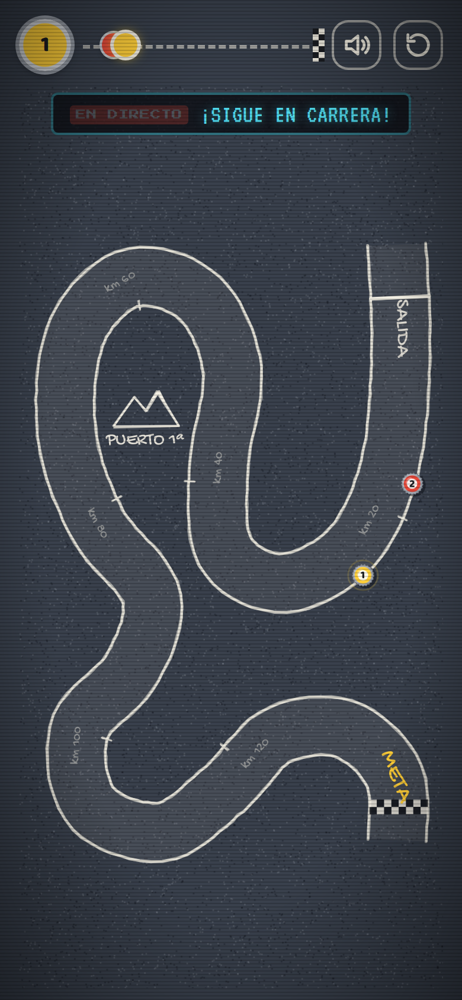
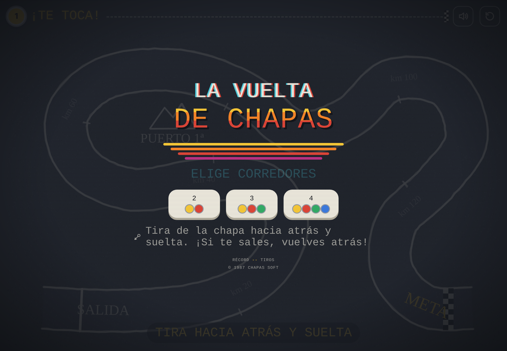
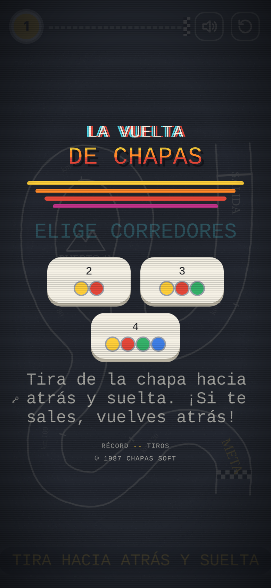
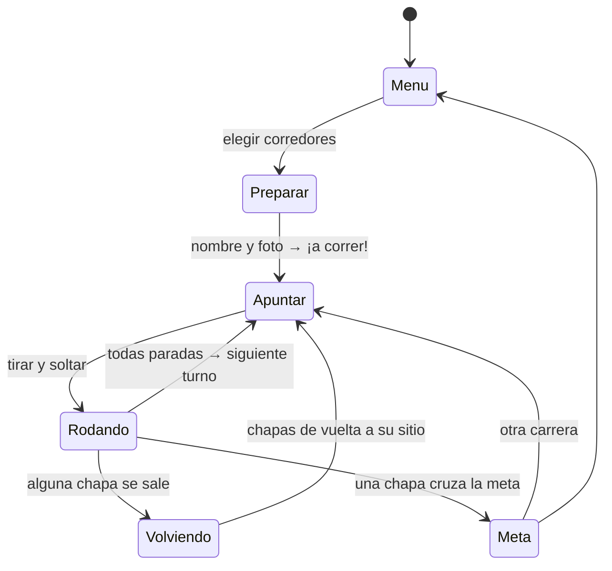

<div align="center">



**🇪🇸 Español** · [🇬🇧 English](README.en.md)

**Juego de chapas de los 80: la vuelta ciclista por turnos, para jugar en el móvil o la tablet.**<br>
Hecho para jugar con mis hijas.

[](https://serbenda.github.io/chapas/)


</div>

---

## 🚴 La idea

¿Te acuerdas de pintar un circuito con tiza en el suelo del patio y pasarte la tarde tirando chapas con la foto de tu ciclista favorito? **La Vuelta de Chapas** recupera ese juego para que lo disfrute una generación nueva, en el móvil o la tablet, con la estética de las recreativas de los 80.

<div align="center">

</div>

## 📸 Capturas

| Tablet | Móvil |
| :---: | :---: |
|  |  |
|  |  |

> Las capturas y el GIF los genera automáticamente un robot que juega una partida de verdad cada vez que cambia el juego (ver [Capturas automáticas](#-capturas-automáticas)).

## 🎮 Cómo se juega

1. **Elige cuántos corredores** juegan: de 2 a 4, en el mismo móvil o tablet.
2. **Pon tu nombre y tu foto** en tu chapa (opcional: si no, juegas con tu color).
3. **Por turnos**, cuando salga el cartel con tu chapa, toca la pantalla, **tira hacia atrás** como un tirachinas y **suelta**.
4. La flecha indica la dirección y la fuerza: 🟢 suave · 🟡 media · 🔴 a tope.
5. **Gana la primera chapa que cruce la meta** a cuadros.

### 📜 Reglas del patio

| Situación | Qué pasa |
| --- | --- |
| La chapa se sale de la carretera | `¡FUERA!` Vuelve a donde estaba antes del tiro. En **modo fácil** rebota en las vallas |
| Chocas con otra chapa | La empujas. Si la sacas de la carretera, también vuelve a su sitio |
| Cruzas la meta | ¡Ganas la etapa! Confeti y fanfarria |
| Ganas en menos tiros que nadie | `¡NUEVO RÉCORD!` Se guarda en ese aparato |

## 📻 El locutor

Un locutor de radio *EN DIRECTO* comenta cada tirada, letra a letra, como en las retransmisiones de antes:

| Cuándo | Qué dice |
| --- | --- |
| Tirada larga | *¡Qué demarraje!* · *¡Se escapa! ¡Se escapa!* |
| Tirada corta | *¡Pájara! Se ha quedado sin fuerzas* |
| Te sales | *¡Uy, a la cuneta! ¡Vuelta atrás!* |
| Choque | *¡Chocazo en el pelotón!* |
| Adelantas a todos | *¡Nuevo líder: Rojo!* |

## ✨ Características

- 🕹️ **Estética de recreativa de los 80**: letras pixeladas, efecto de tele de tubo y música de 8 bits generada en directo con Web Audio.
- 🖍️ **Circuito de tiza** sobre asfalto, con salida, kilómetros, puerto de 1ª categoría y meta.
- 🍾 **Chapas fieles a las de verdad**: corona de 21 dientes, maillot de color y dorsal.
- 📸 **Tu foto dentro de la chapa**, como las de los ciclistas de antes, y tu nombre en el marcador. Se recuerdan para la próxima partida.
- 👆 **Tutorial sin texto**: la primera vez, una mano enseña el gesto de tirar y soltar.
- 🚧 **Modo fácil con vallas** rojas y blancas: la chapa rebota en vez de salirse. Ideal para los más pequeños.
- 🏆 **Podio final** con los tres primeros en sus cajones.
- 📳 **Sonido de chapa de verdad** (un *clac* metálico sintetizado) y **vibración** en los choques en Android.
- 📢 **Cartel de turno** a pantalla completa con la chapa girando: siempre se sabe a quién le toca.
- 🔍 **Cámara con zoom en el móvil**: sigue a la chapa que tira para que se vea grande, y un botón enseña el circuito entero.
- 📱 **Se adapta a cualquier pantalla**: en vertical, el circuito gira para aprovechar el móvil.
- 📦 **App instalable (PWA)**: icono propio, pantalla completa y **funciona sin internet**.
- 🧒 **Pensado para niños de 6 a 8 años**: casi sin texto, botones grandes y sin castigos duros.
- 🔒 **Sin anuncios, sin cuentas y sin recoger datos.** Las fotos se quedan en el propio móvil y nunca se suben a ningún sitio.

## 📲 Instalar en el móvil

| Android (Chrome) | iPhone / iPad (Safari) |
| --- | --- |
| Abre [serbenda.github.io/chapas](https://serbenda.github.io/chapas/) → menú **⋮** → **Instalar aplicación** | Abre [serbenda.github.io/chapas](https://serbenda.github.io/chapas/) → **Compartir** → **Añadir a pantalla de inicio** |

Después de abrirlo una vez con conexión, ya se puede jugar sin internet.

## 🛠️ Bajo el capó

Todo el juego vive en **un único `index.html`**, sin frameworks ni librerías: HTML, CSS y JavaScript a pelo dibujando sobre un `<canvas>`.



| Pieza | Cómo funciona |
| --- | --- |
| **Circuito** | Curva *Catmull-Rom* sobre 23 puntos de control, remuestreada cada 6 unidades para medir el avance y detectar salidas |
| **Física** | Paso fijo a 60 Hz con 4 subpasos, rozamiento del 2,8 % por fotograma y choques elásticos entre chapas |
| **Salidas** | En cada subpaso se busca el punto más cercano de la carretera en una ventana local (así no hay atajos saltando de un tramo a otro) |
| **Pantalla** | El mundo mide 1000 × 620 y se escala a la pantalla; en vertical se transpone, y los textos y las fotos se dibujan aparte para que nunca salgan en espejo |
| **Cámara** | Si la chapa saldría de menos de 30 px, la cámara se acerca y la sigue con suavizado; el fondo se pinta una vez a la resolución del zoom y luego solo se recorta |
| **Vallas** | En modo fácil, si la chapa llega al borde se recoloca dentro y su velocidad se refleja sobre la normal de la carretera, perdiendo un 30 % |
| **Fotos** | Se recortan en cuadrado a 160 px en JPEG y se guardan en `localStorage`: nunca salen del aparato |
| **Sonido** | Efectos y música de 8 bits sintetizados con osciladores de Web Audio: no hay archivos de audio |
| **Offline** | Un *service worker* guarda el juego y las fuentes la primera vez |

### 📁 Estructura

```
chapas/
├── index.html               # El juego completo
├── manifest.webmanifest     # Datos para instalarlo como app
├── sw.js                    # Service worker: juego sin internet
├── icon-*.png               # Iconos de chapa
├── docs/                    # Capturas y GIF del README (automáticos)
├── scripts/
│   ├── capturas.mjs         # Robot que juega y hace las capturas
│   └── banner.html          # Cabecera del README
└── .github/workflows/
    ├── capturas.yml         # Ejecuta el robot en cada cambio
    └── pages.yml            # Publica el juego en GitHub Pages
```

### 💻 Probarlo en local

```bash
git clone https://github.com/serbenda/chapas.git
cd chapas
python3 -m http.server 8000
# abre http://localhost:8000
```

> Si cambias `index.html`, sube la versión en `sw.js` (`chapas-v4` → `chapas-v5`) para que los móviles descarguen la nueva.

### 🌿 Ramas

| Rama | Para qué |
| --- | --- |
| `main` | Versión estable: es la que se publica en [serbenda.github.io/chapas](https://serbenda.github.io/chapas/) |
| `development` | Donde se prueban las novedades antes de pasar a `main` con un *pull request* |

### 🤖 Capturas automáticas

Cada vez que cambia el juego, [GitHub Actions](.github/workflows/capturas.yml) abre el juego en un Chromium real con **Playwright**, juega una partida, saca las capturas en tablet y móvil, monta el GIF con **ffmpeg** y lo sube a `docs/`. También se puede lanzar a mano desde la pestaña *Actions*.

## 🗺️ Hoja de ruta

- [x] Vuelta ciclista para 2 a 4 jugadores
- [x] Estilo retro: música de 8 bits, locutor y récord
- [x] App instalable que funciona sin internet
- [x] Tu nombre y tu foto en la chapa
- [x] Cartel de turno y zoom en el móvil
- [ ] ⚽ Modo fútbol de chapas
- [x] Modo fácil con vallas, tutorial, podio, vibración y sonido de chapa
- [ ] Vuelta por etapas con maillot amarillo y de la montaña
- [ ] Jugar contra la máquina
- [ ] Más circuitos: contrarreloj, alta montaña, circuito urbano
- [ ] Obstáculos: charcos, adoquines y bordillos

## ⚖️ Licencia

© 2026 Santiago. **Todos los derechos reservados.** Puedes jugar y ver el código, pero no copiarlo, modificarlo ni redistribuirlo sin permiso. Ver [LICENSE](LICENSE).

Fuentes: *Press Start 2P*, *VT323*, *Gochi Hand* y *Baloo 2*, de Google Fonts, con licencia SIL Open Font License.

<div align="center">
<br>
<sub>Hecho con 🖍️ tiza, 🍾 chapas y mucha nostalgia · © 1987 CHAPAS SOFT</sub>
</div>
