<div align="center">


**🇪🇸 Español** · [🇬🇧 English](README.en.md)

**Juego de chapas de los 80: la vuelta ciclista y el fútbol de chapas, por turnos, para jugar en el móvil o la tablet.**<br>
Hecho para jugar con mis hijas.

[](https://serbenda.github.io/chapas/)

[](https://github.com/serbenda/chapas/actions/workflows/tests.yml)


</div>

---

## 🚴 La idea

¿Te acuerdas de pintar un circuito con tiza en el suelo del patio y pasarte la tarde tirando chapas con la foto de tu ciclista favorito? **La Vuelta de Chapas** recupera ese juego para que lo disfrute una generación nueva, en el móvil o la tablet, con la estética de las recreativas de los 80.

<table>
<tr>
<td width="34%" align="center" valign="top">
<br>
<sub><b>Una partida en el móvil:</b> la manita enseña el gesto y la máquina juega su turno</sub>
</td>
<td width="66%" valign="top">

### En 30 segundos

- 👆 **Tira hacia atrás y suelta**, como un tirachinas.
- 🛣️ **Si te sales, vuelves atrás.** O juega con vallas en el modo fácil.
- ⚽ **Dos juegos**: **ciclismo** y **fútbol de chapas**.
- 🏔️ **4 etapas**: llana, montaña, adoquines y gran final.
- 💛 **Maillot amarillo y de lunares**, con clasificación general.
- 🤖 **Juega contra la máquina**, que tiene 3 niveles.
- 📸 **Tu foto dentro de la chapa**, como las de antes.
- 📻 **Un locutor** que comenta cada tirada.

</td>
</tr>
</table>

## 🗺️ Las cuatro etapas

| | |
| :---: | :---: |
| 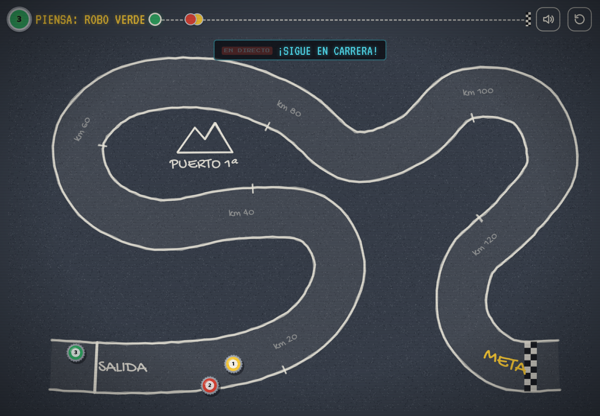 | 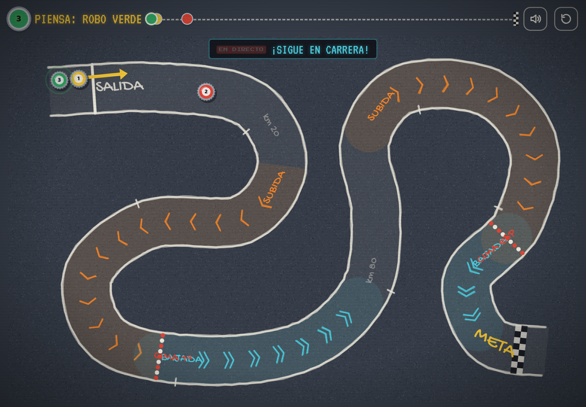 |
| **1 · Llana**: para coger el truco | **2 · Montaña**: subidas que frenan, bajadas que lanzan y dos premios de montaña |
| 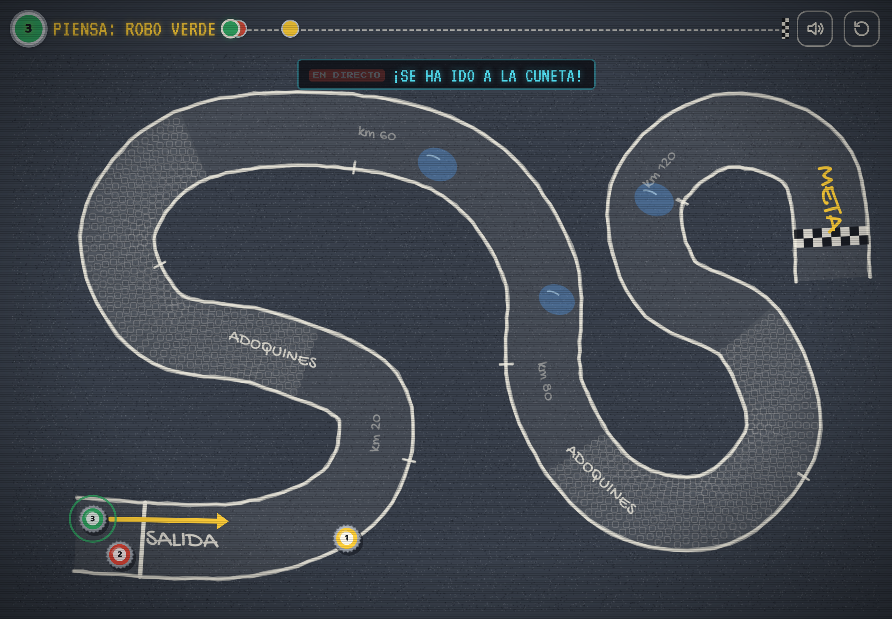 | 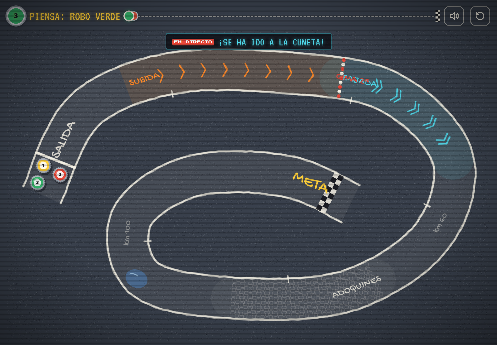 |
| **3 · Adoquines**: la chapa bota y los charcos la hacen resbalar | **4 · Gran final**: un poco de todo, con la meta en el centro de la espiral |

## ⚽ Fútbol de chapas

| Partido contra la máquina | ¡Gol! |
| :---: | :---: |
|  | 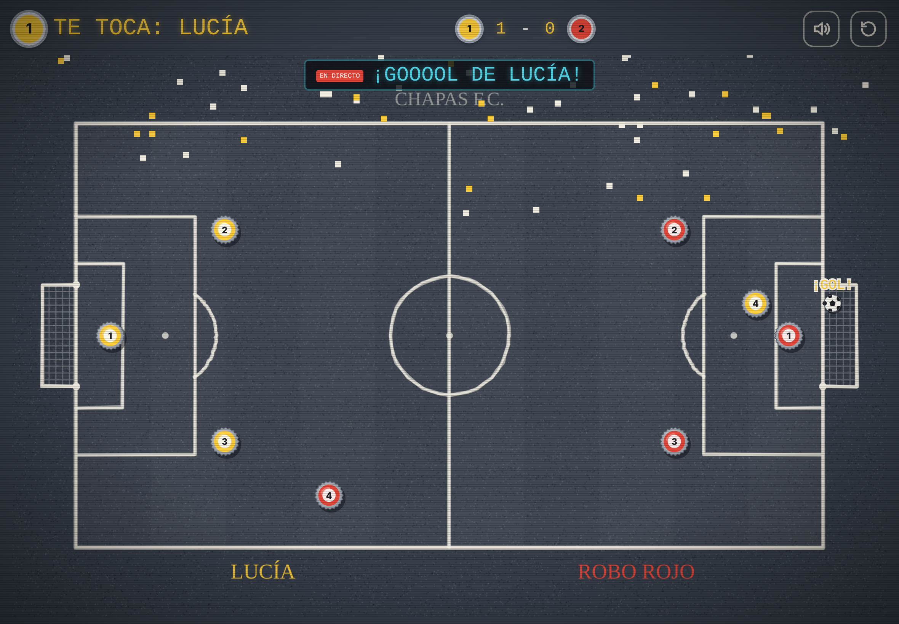 |

Cada equipo tiene **4 chapas** (portero, dos defensas y un delantero) y se juega por turnos: **eliges una de tus chapas**, la tiras y tiene que golpear el balón. El campo tiene bordillo, así que nada se sale, y gana quien llegue antes a **3 o 5 goles**. Tras cada gol, saca el equipo que lo ha recibido.

## 🏆 Clasificación y podio

| Clasificación general de la Vuelta | Podio de etapa |
| :---: | :---: |
| 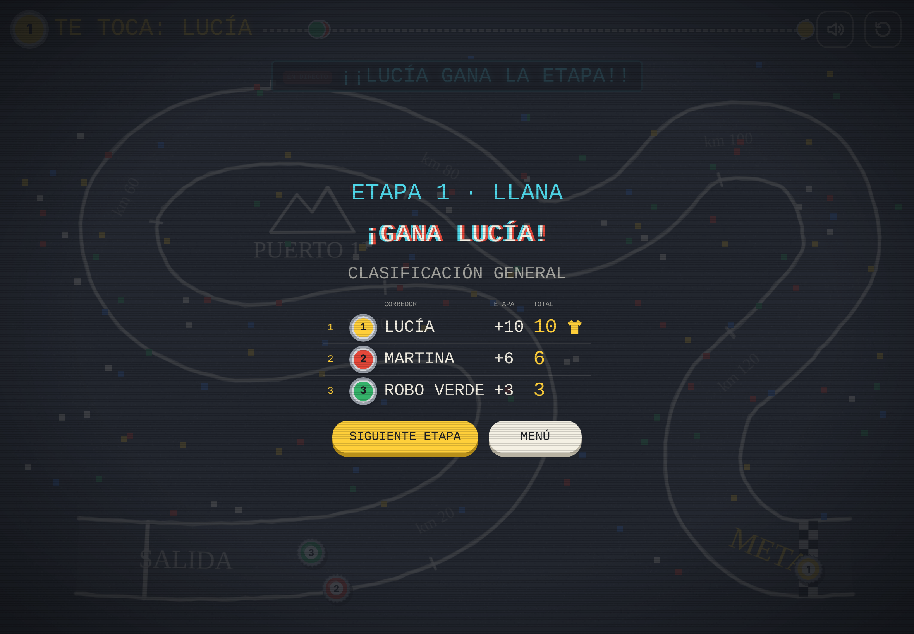 | 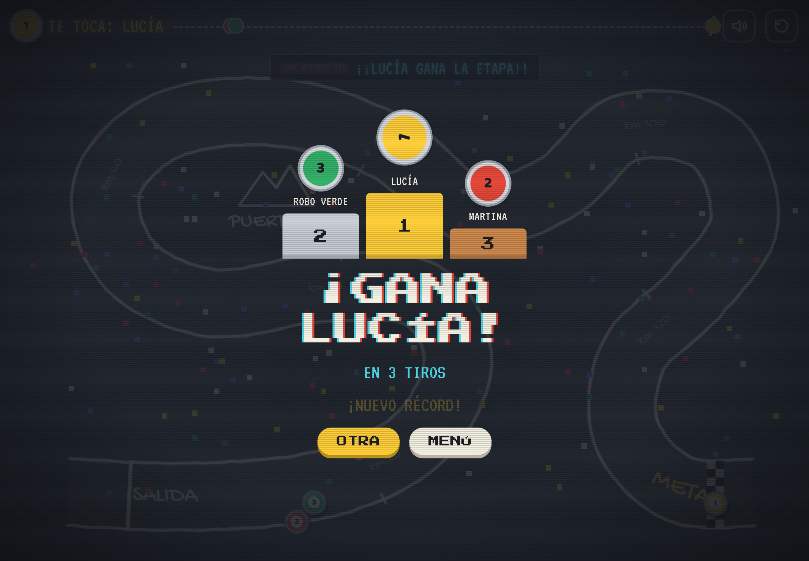 |

## 📱 En el móvil

| Menú | Corredores | Carrera | Fútbol |
| :---: | :---: | :---: | :---: |
| 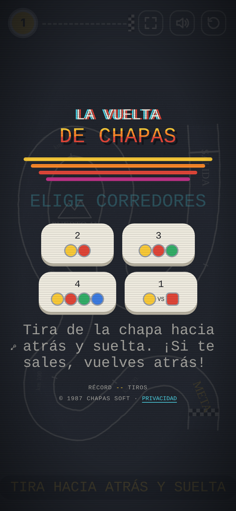 | 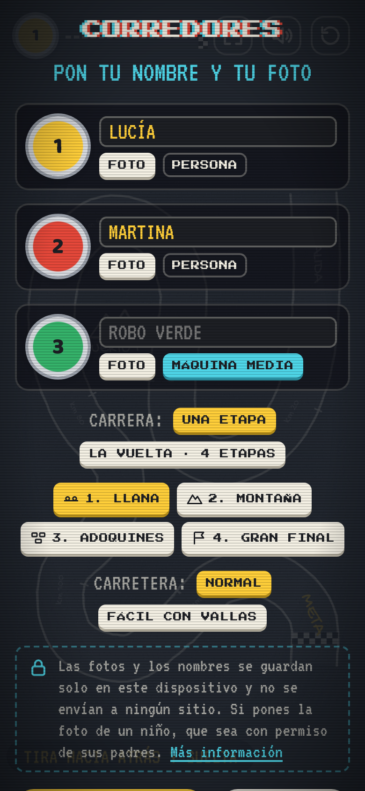 | 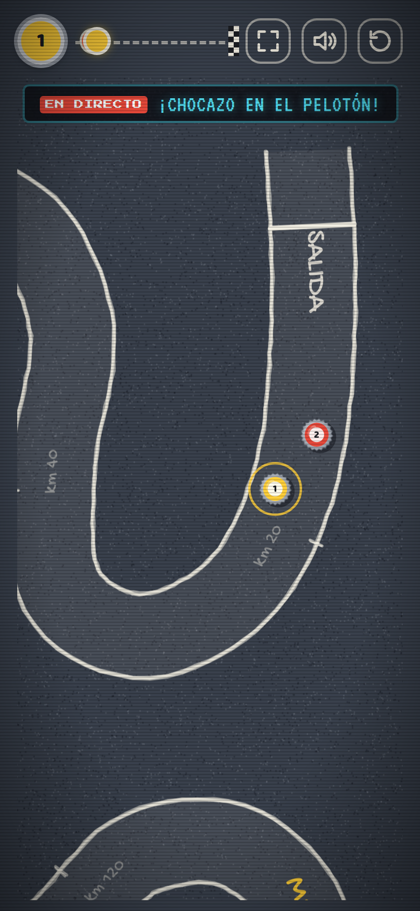 | 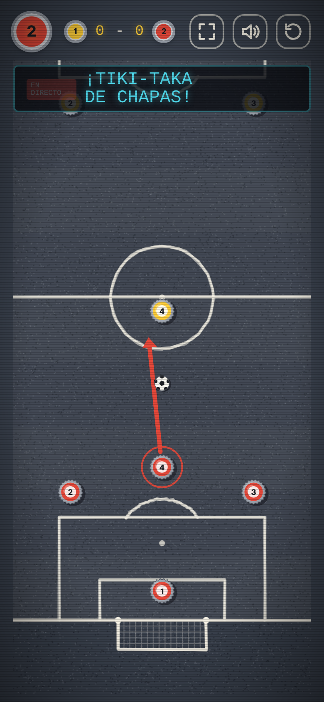 |
| **Ciclismo** o **fútbol**, y para cuántos | Nombre, foto, persona o máquina, y tipo de carrera | La cámara se acerca a la chapa que tira | La cámara sigue al balón |

> Todas las imágenes las genera automáticamente un robot que juega partidas de verdad cada vez que cambia el juego (ver [Capturas automáticas](#-capturas-automáticas)).

## 🎮 Cómo se juega

### 🚴 Ciclismo

1. **Elige CICLISMO** en el menú y cuántos corredores juegan: de 2 a 4 en el mismo móvil o tablet, o 1 contra la máquina.
2. **Pon tu nombre y tu foto** en tu chapa, y elige si cada chapa la lleva una persona o la máquina.
3. **Elige la carrera**: una etapa suelta o **La Vuelta** completa, de 4 etapas.
4. **Por turnos**, cuando salga el cartel con tu chapa, toca la pantalla, **tira hacia atrás** y **suelta**. La flecha indica la fuerza: 🟢 suave · 🟡 media · 🔴 a tope.
5. **Gana la primera chapa que cruce la meta.** En La Vuelta, gana quien sume más puntos.

### 📜 Reglas del patio

| Situación | Qué pasa |
| --- | --- |
| La chapa se sale de la carretera | `¡FUERA!` Vuelve a donde estaba antes del tiro. En **modo fácil** rebota en las vallas |
| Chocas con otra chapa | La empujas. Si la sacas de la carretera, también vuelve a su sitio |
| **Subida** 🟧 | La chapa frena más |
| **Bajada** 🟦 | La chapa corre más |
| **Adoquines** | La chapa bota y se desvía un poco |
| **Charco** 💧 | Resbala y se va girando |
| Cruzas la meta | Ganas la etapa |

### ⚽ Fútbol

1. **Elige FÚTBOL** en el menú: 2 jugadores o 1 contra la máquina.
2. Pon nombre y foto a tu equipo (la foto sale en tus 4 chapas) y elige a cuántos goles se juega.
3. En tu turno, **toca una de tus chapas** (brillan las de tu equipo), tira hacia atrás y suelta.
4. Si el balón entra entero en la portería rival, **¡gol!**

### 💛 Puntos y maillots (La Vuelta)

| | Puntos | Maillot |
| --- | --- | --- |
| **Llegada** | 1.º 10 · 2.º 6 · 3.º 3 · 4.º 1 | **Amarillo** para el líder de la general |
| **Cima** (al acabar la tirada por encima) | 1.º 5 · 2.º 3 · 3.º 1 | **De lunares** para el rey de la montaña |

Los maillots se ven como un aro alrededor de la chapa durante la carrera.

## 🤖 La máquina

La máquina no hace trampas: **prueba decenas de tiros con la misma física del juego** y se queda con el que más avanza sin salirse. Entre los mejores, elige el más seguro, el que sigue saliendo bien aunque el pulso tiemble un poco. Después lo ejecuta con un error que depende del nivel:

| Nivel | Tiros que prueba | Puntería |
| --- | --- | --- |
| Fácil | ~54 | Se equivoca bastante: ideal para que ganen los peques |
| Media | ~104 | Buena |
| Difícil | ~228 | Casi perfecta |

La máquina del **fútbol** hace lo mismo con cada una de sus 4 chapas: apunta para golpear el balón por detrás en línea con tu portería, prueba varias direcciones y fuerzas, y elige la jugada que más acerca el balón a tu portería sin dejarlo cerca de la suya.

## 📻 El locutor

Un locutor de radio *EN DIRECTO* comenta cada tirada, letra a letra, como en las retransmisiones de antes:

| Cuándo | Qué dice |
| --- | --- |
| Tirada larga | *¡Qué demarraje!* · *¡Se escapa! ¡Se escapa!* |
| Tirada corta | *¡Pájara! Se ha quedado sin fuerzas* |
| Te sales | *¡Uy, a la cuneta! ¡Vuelta atrás!* |
| Choque | *¡Chocazo en el pelotón!* |
| En la subida | *¡Qué dura es la subida!* |
| En los adoquines | *¡Cómo bota en los adoquines!* |
| Coronas una cima | *¡Lucía corona la cima en cabeza!* |
| Adelantas a todos | *¡Nuevo líder: Rojo!* |
| ⚽ Gol | *¡GOOOOL de Lucía!* · *¡Gol en propia puerta!* |
| ⚽ Balón al poste | *¡Al palo! ¡Uyyy!* |
| ⚽ Sin tocar el balón | *¡Ni rozarlo!* |

## ✨ Características

- 🕹️ **Estética de recreativa de los 80**: letras pixeladas, efecto de tele de tubo y música de 8 bits generada en directo.
- 🖍️ **Circuitos de tiza** sobre asfalto, con salida, kilómetros, cimas, terreno y meta a cuadros.
- 🍾 **Chapas fieles a las de verdad**: corona de 21 dientes, maillot de color, dorsal y **tu foto**.
- 👆 **Tutorial sin texto**: la primera vez, una mano enseña el gesto.
- 🚧 **Modo fácil con vallas**, para los más pequeños.
- 📢 **Cartel de turno** y **cámara con zoom** en el móvil.
- 📳 **Sonido de chapa de verdad** y **vibración** en Android.
- 📦 **App instalable (PWA)** que **funciona sin internet**.
- 🔒 **Sin anuncios, sin cuentas y sin recoger datos.**

## 🔒 Privacidad

El juego está pensado para cumplir el RGPD y la LOPDGDD sin tener que pedir nada a nadie: **no trata datos personales fuera del propio dispositivo**.

| | |
| --- | --- |
| **Qué se guarda** | Nombre, foto (recortada a 160 × 160 px) y tipo de cada chapa, récords por etapa y preferencias |
| **Dónde** | Solo en el `localStorage` del navegador de ese móvil o tablet. Nada se envía a ningún servidor |
| **Qué no hace** | Sin cookies, sin analítica, sin publicidad y sin rastreadores |
| **Fuentes** | Al publicar, las letras se copian a la propia web: el juego no hace peticiones a Google |
| **Fotos de menores** | El juego avisa de que solo se ponga la foto de un niño con permiso de sus padres o tutores |
| **Borrar** | Botón **QUITAR** en cada foto o **BORRAR MIS DATOS** en la pantalla de *Privacidad* |

## 📲 Instalar en el móvil

| Android (Chrome) | iPhone / iPad (Safari) |
| --- | --- |
| Abre [serbenda.github.io/chapas](https://serbenda.github.io/chapas/) → menú **⋮** → **Instalar aplicación** | Abre [serbenda.github.io/chapas](https://serbenda.github.io/chapas/) → **Compartir** → **Añadir a pantalla de inicio** |

Después de abrirlo una vez con conexión, ya se puede jugar sin internet.

## 🛠️ Bajo el capó

HTML, CSS y JavaScript a pelo, en **módulos ES sin dependencias ni paso de compilación**, dibujando sobre un `<canvas>`.

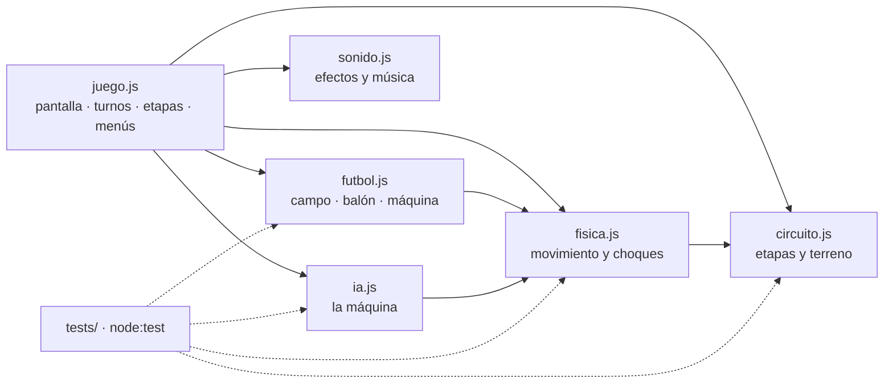

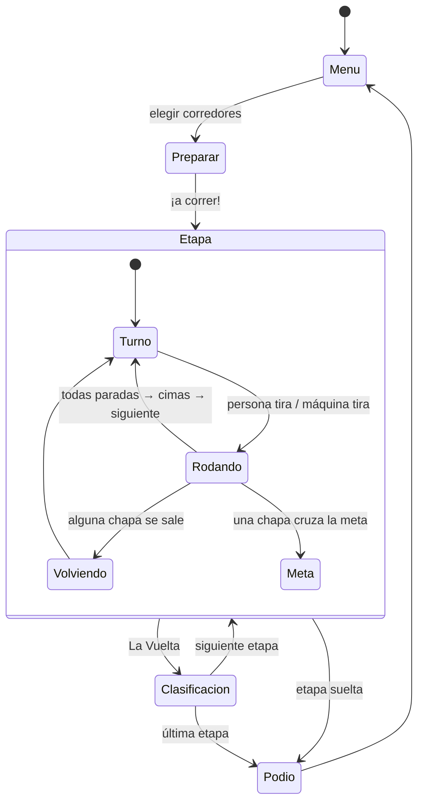

| Pieza | Cómo funciona |
| --- | --- |
| **Circuitos** | Curvas *Catmull-Rom* remuestreadas cada 6 unidades; el terreno, las cimas y los charcos se definen como fracción del recorrido |
| **Física** | Módulo puro: paso fijo a 60 Hz con 4 subpasos, rozamiento según el terreno y choques elásticos. Devuelve eventos (`fuera`, `choque`, `valla`, `meta`) |
| **Salidas** | En cada subpaso se busca el punto más cercano de la carretera en una ventana local: no hay atajos saltando de un tramo a otro |
| **Máquina** | Simula cada tiro candidato con la misma física, puntúa avance y distancia al borde, comprueba la robustez de los mejores y añade error según el nivel |
| **Pantalla** | El mundo mide 1000 × 620; en vertical se transpone, y los textos y fotos se dibujan aparte para que nunca salgan en espejo |
| **Cámara** | Si la chapa se vería pequeña, se acerca y la sigue; el fondo se pinta una vez a la resolución del zoom y luego solo se recorta |
| **Sonido** | Efectos y música sintetizados con Web Audio: no hay archivos de audio |
| **Fútbol** | Mismo motor de tiro; física propia con masas (el balón pesa la mitad y rueda más), bordillo con huecos en las porterías, postes y gol cuando el balón cruza entero la línea |
| **Offline** | Un *service worker* guarda el juego y los módulos la primera vez |

### 📁 Estructura

```
chapas/
├── index.html               # Estructura y estilos
├── js/
│   ├── juego.js             # Pantalla, cámara, dibujo, turnos, etapas y menús
│   ├── circuito.js          # Las 4 etapas: trazado, terreno, cimas y charcos
│   ├── fisica.js            # Movimiento, choques, vallas y terreno (puro)
│   ├── ia.js                # La máquina del ciclismo
│   ├── futbol.js            # Fútbol: campo, balón, goles y su máquina (puro)
│   └── sonido.js            # Efectos y música de 8 bits
├── tests/
│   ├── fisica.test.mjs      # Tests de circuitos, física y máquina
│   └── futbol.test.mjs      # Tests del fútbol
├── manifest.webmanifest     # Datos para instalarlo como app
├── sw.js                    # Service worker: juego sin internet
├── docs/                    # Imágenes del README (automáticas)
├── scripts/
│   ├── capturas.mjs         # Robot que juega y hace las capturas
│   ├── empaquetar.mjs       # Junta todo en un único HTML
│   ├── fuentes_locales.py   # Copia las fuentes a la web al publicar
│   └── banner.html          # Cabecera del README
└── .github/workflows/
    ├── tests.yml            # Tests en cada cambio y pull request
    ├── capturas.yml         # Rehace las imágenes del README
    └── pages.yml            # Publica el juego en GitHub Pages
```

### 💻 Probarlo en local

```bash
git clone https://github.com/serbenda/chapas.git
cd chapas
python3 -m http.server 8000      # los módulos no cargan desde file://
# abre http://localhost:8000

node --test tests/*.test.mjs     # tests
```

> Si cambias el juego, sube la versión en `sw.js` (`chapas-v7` → `chapas-v8`) para que los móviles descarguen la nueva.

### 🌿 Ramas

| Rama | Para qué |
| --- | --- |
| `main` | Versión estable: es la que se publica en [serbenda.github.io/chapas](https://serbenda.github.io/chapas/) |
| `development` | Donde se prueban las novedades antes de pasar a `main` con un *pull request* |

### 🤖 Capturas automáticas

Cada vez que cambia el juego, [GitHub Actions](.github/workflows/capturas.yml) lo abre en un Chromium real con **Playwright**, juega partidas en las cuatro etapas, saca las capturas en tablet y móvil, monta el GIF con **ffmpeg** y lo sube a `docs/`.

## 🗺️ Hoja de ruta

- [x] Vuelta ciclista para 2 a 4 jugadores
- [x] Estilo retro: música de 8 bits, locutor y récord
- [x] App instalable que funciona sin internet
- [x] Tu nombre y tu foto en la chapa
- [x] Cartel de turno y zoom en el móvil
- [x] Modo fácil con vallas, tutorial, podio, vibración y sonido de chapa
- [x] La Vuelta por etapas con maillot amarillo y de lunares
- [x] Terreno: subidas, bajadas, adoquines y charcos
- [x] Jugar contra la máquina, con 3 niveles
- [x] Código en módulos y tests automáticos
- [x] ⚽ Fútbol de chapas, contra otra persona o contra la máquina
- [ ] El juego también en inglés

## ⚖️ Licencia

© 2026 Santiago. **Todos los derechos reservados.** Puedes jugar y ver el código, pero no copiarlo, modificarlo ni redistribuirlo sin permiso. Ver [LICENSE](LICENSE).

Fuentes: *Press Start 2P*, *VT323*, *Gochi Hand* y *Baloo 2*, de Google Fonts, con licencia SIL Open Font License.

<div align="center">
<br>
<sub>Hecho con 🖍️ tiza, 🍾 chapas y mucha nostalgia · © 1987 CHAPAS SOFT</sub>
</div>
